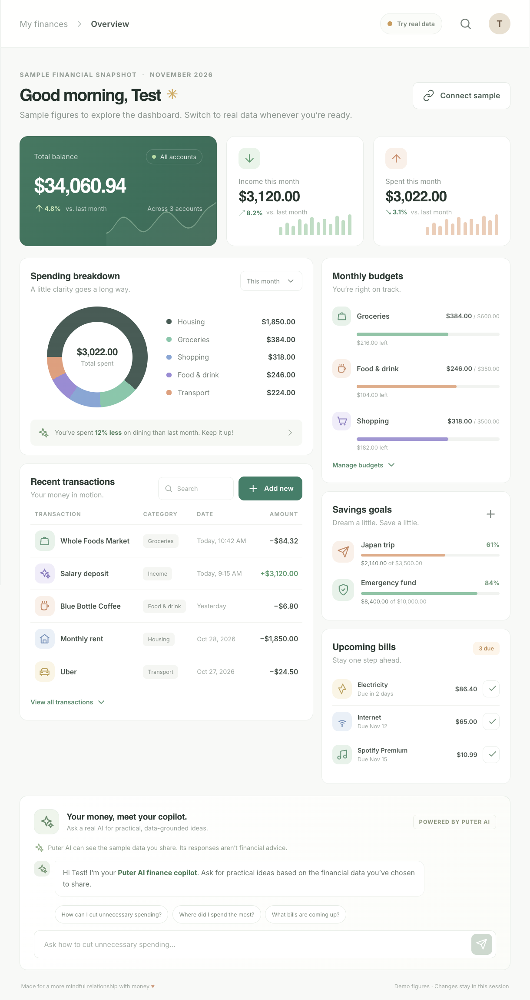

# Pocketful Finance

A responsive personal finance dashboard with real username/password accounts, private per-user finance records, and a sample-data demo mode. Create an account or sign in to access the dashboard.



## Run locally

Requires Node.js 20.9 or newer.

```bash
npm install
npm run dev
```

Open [http://localhost:3000](http://localhost:3000) and create an account with a username and a password between 9 and 32 characters. The dashboard starts in demo mode. Choose **Try real data** to switch modes; demo figures remain separate from your saved records.

In real-data mode, manually add accounts with opening balances, transactions, upcoming bills, budgets, and savings goals. These entries are stored in the local SQLite database and associated with your signed-in account. Marking a bill paid records the payment as a transaction. The app does not connect to banks, import statements, or automatically receive transactions.

## Finance copilot

The copilot uses Puter AI in the browser (`gpt-5.4-nano`) and generates replies from the question and relevant finance summaries. The first question asks permission before sharing that information with Puter. You may need to sign in to Puter; Puter handles its own usage and billing under its user-pays model. Review [Puter's documentation and terms](https://docs.puter.com/) before sharing financial information. The AI can make mistakes and is not a financial advisor.

## Authentication

- Usernames are 3–32 letters, numbers, underscores, or hyphens.
- Passwords are 9–32 characters and are hashed with Node.js `scrypt`; plaintext passwords are not stored.
- Session tokens are random, stored as hashes in SQLite, expire after seven days, and are sent in `HttpOnly`, `SameSite=Strict` cookies (`Secure` in production).
- The dashboard is rendered only after the server validates the session. Sign out revokes the stored session.
- SQLite is suitable for a single self-hosted server with persistent disk storage. This setup is not intended for serverless or multi-instance deployments. Use a managed database and deployment-appropriate auth/session infrastructure for those environments.

## Demo boundaries

- Demo figures are sample data and are not tied to users or persisted. Changes made in demo mode are temporary.
- Real mode saves user-entered finance data in SQLite, but it does not connect to banks or sync with financial institutions.
- The finance copilot is a live Puter AI integration, not a financial advisor. It receives the question and the displayed finance summaries only after the user consents.
